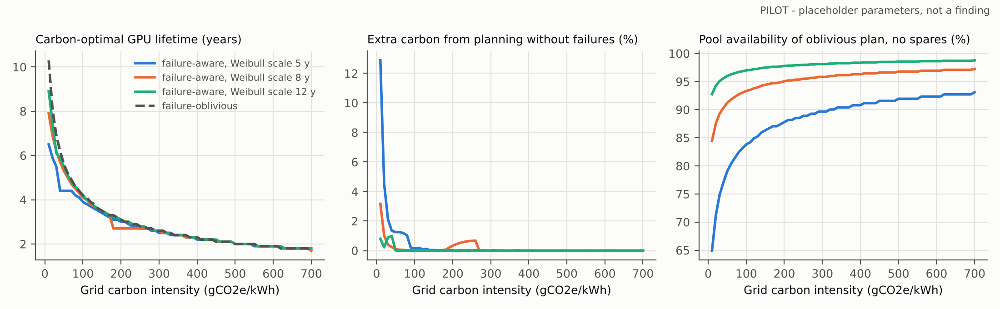
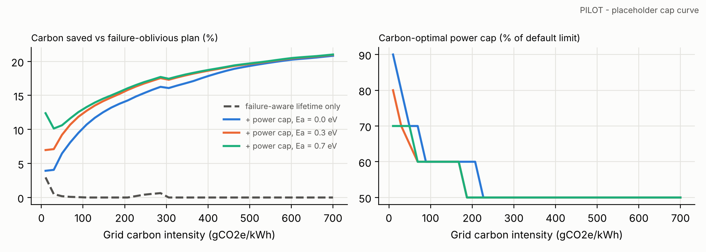
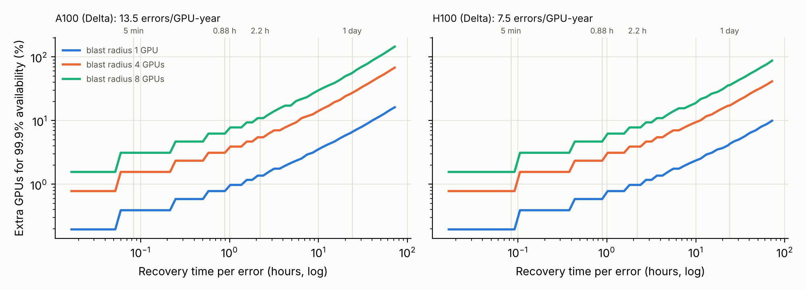

# calf — reliability- and uncertainty-aware carbon planning for LLM inference fleets

> **Status: early research prototype (pilot).** Numbers in this repo come from
> placeholder parameters until `docs/assumptions.md` says otherwise. Do not cite them.

Carbon-aware inference design (e.g. EcoServe) says to keep hardware longer on clean grids so
its embodied carbon is spread over more years. Older hardware also fails more often, needs
spare capacity, and must still meet latency SLOs. **This project asks how much of that
"keep it longer" saving survives realistic failures and uncertainty, and how operators
should plan GPU and host lifetimes, spares and fleet mix as a result.**



*Pilot (assumed parameters): failures barely matter on dirty grids, where hardware is
replaced quickly anyway. On clean grids a failure-oblivious plan keeps GPUs about 8–10
years and misses its availability target badly unless spares are added.*

**Second lever: power capping.** Running GPUs below their default power limit acts on
four carbon terms at once: energy per token, the number of GPUs needed, wear-out (and so
lifetime), and power headroom the grid can call on. `gpu_bench/` measures the power-cap
curve on real GPUs. `experiments/derating.py` turns it into a joint
(power cap, lifetime) optimum.



**Evidence-based headline (in progress):** using published field data (NCSA Delta A100/H100
error rates and recovery times), the extra GPUs needed for 99.9% availability, and so their
embodied carbon, are set mainly by **recovery time × failure blast radius**, not hardware age.



## Quickstart

```bash
pip install -e ".[dev]"
pytest -q
python experiments/pilot_lifetime.py      # -> docs/figures/pilot_lifetime.png
python experiments/derating.py            # -> docs/figures/derating.png (uses GPU data if present)
python experiments/recovery_spares.py     # -> docs/figures/recovery_spares.png (sourced error rates)
```

On a GPU machine (see [`gpu_bench/README.md`](gpu_bench/README.md)):

```bash
bash scripts/setup_gpu_node.sh
python -m gpu_bench.run_sweep configs/gpu/g0_smoke.yaml --quick
```

## Layout

```
configs/        experiment configs (YAML, one per figure)
src/calf/
  models/       reliability.py (hazard, spares), lifetime.py (fleet carbon vs lifetime),
                derating.py (power cap -> throughput, power, temperature, aging)
  optimize/     provisioning MILP, epsilon-constraint Pareto, fuzzy/scenario (planned)
  simulate/     discrete-time fleet simulator (planned)
  data/         carbon-intensity, workload, hardware loaders (planned)
experiments/    one script per figure
gpu_bench/      vLLM + NVML measurement harness (power-cap sweeps, idle power, cold start, faults)
data/measurements/gpu/  committed GPU measurement results
docs/           research_plan.md, related_work.md, assumptions.md, figures/
paper/          outline + references for paper generation
```

## Read next

* [`docs/research_plan.md`](docs/research_plan.md): the research gap, questions, experiments and milestones
* [`docs/assumptions.md`](docs/assumptions.md): every parameter, with source or ASSUMPTION tag
* [`docs/related_work.md`](docs/related_work.md): verified notes on prior work

## Attribution

This project is **inspired by** and builds on published work by Udit Gupta's group and
collaborators, in particular EcoServe (arXiv 2502.05043) and CarbonClarity
(arXiv 2507.01145). It is independent and not affiliated with those authors. It uses
public data only.

## License

TBD (MIT or Apache-2.0).
